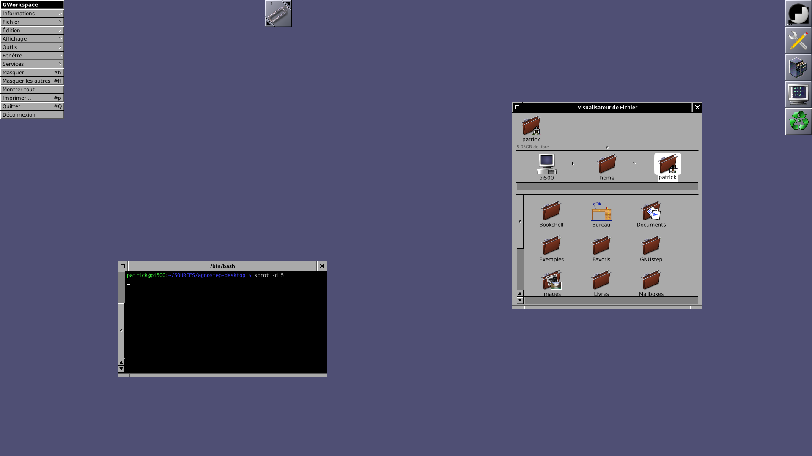

# AGNoStep: agnostep-desktop

This is the core component of [AGNoStep](../../../agnostep/README.md) project: its Desktop. It is provided under the [MIT License](LICENSE).
To understand the whole project and how the components work together, read [AGNoStep Main Documentation](../agnostep/Documentation), mainly its [Overwiew](../../../agnostep/Documentation/OVERVIEW.md).

- Read [RELEASE](Documentation/RELEASE.md) to know the current status.
- See [CHANGES](Documentation/CHANGES.md) to read the details of the latest changes.

## Screenshot

AGNostep-desktop Classic with defaults GNUstep theme. This Third Release is minimalist.



## Components

This Third release provide a choice between Classic and Modern Desktop.

### Of the Classic Desktop

This Core Desktop provides:

- The Legacy GNUstep System built from latest commits with the GNU Compiler: GCC.
- Window Manager: Window Maker.
- Workspace: GWorkspace built from the latest commits.
- Dock: Window Maker own Dock.
- Other Core Applications: SystemPreferences, Terminal.

### Of the Modern Desktop

This Core Desktop provides:

- Grand Central Dispatch.
- The Modern GNUstep System (libobjc2) built from latest commits with the Clang compiler.
- Window Manager: gnustep-window-manager by Joseph Maloney.
- Workspace: *Finder* (FileViewer) by Greg Casamento.
- Dock: WMDock by Greg Casamento.
- Other Core Applications: SystemPreferences, Terminal.

## How to install

Read [INSTALL](Documentation/INSTALL.md) first to understand all the stages.

**Quick way**: on a fresh minimal Debian Trixie (13.x) on a computer wired to Internet, clone this repo and then execute:

```console	
	./agnowiz.sh
```

It will show up **Agnostep Wizard**.

From the main menu:

1. **Prepare** the environment: item 'Prep'.
2. Install the **Core Desktop**: item  'Core'.
1. Install the **Core apps**: item 'Apps'.
1. Set the X session for the user with **Settings**.

Then try it with:

```console
	cd && startx
```

If all is right and expected, logout the desktop and run again `Agnostep Wizard`:

```console	
	./agnowiz.sh
```

From the main menu, choose **"DM"** item to install the Display Manager.
